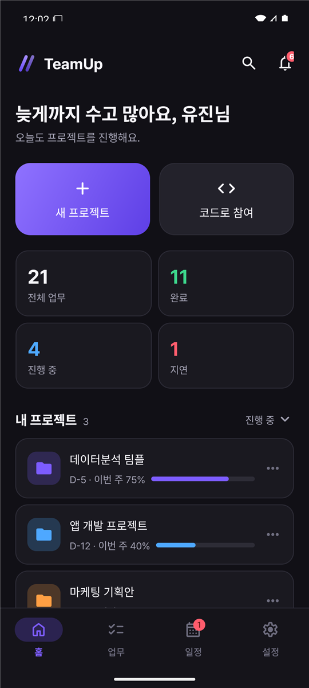
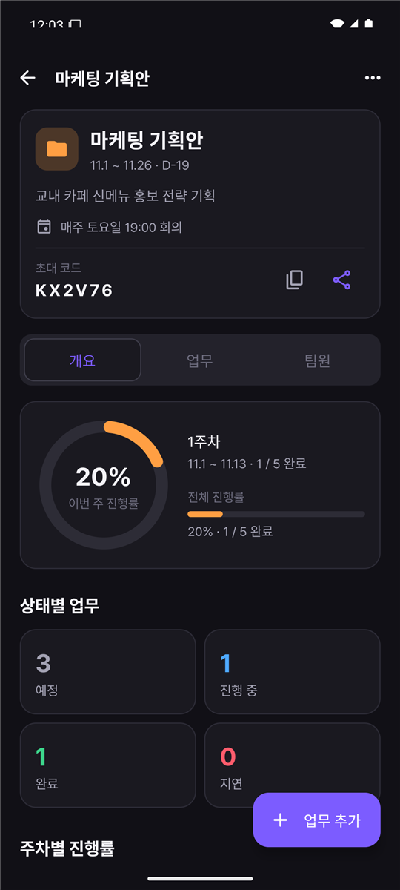
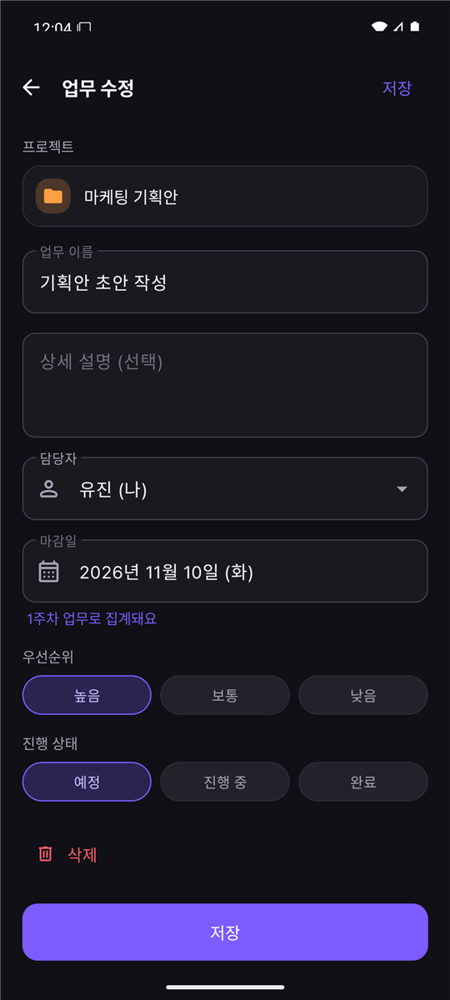

# TeamUp — 팀 프로젝트 관리 앱

팀원 각자가 자기 폰에서 맡은 업무를 체크하면, 모든 팀원 화면의 진행률이 실시간으로 바뀌는 팀 프로젝트 관리 앱입니다.
매주 회의하는 팀에 맞춰 **회의일 기준 주간 진행률**을 기본으로 보여 줍니다.

> **아이폰 사용자라면** → [GUIDE.md](GUIDE.md): PC에서 가상 안드로이드 폰으로 실행하는 방법

| 홈 | 프로젝트 상세 | 업무 수정 |
|---|---|---|
|  |  |  |

## 1. 바로 설치해서 써 보기 (APK)

1. `release/TeamUp-v0.1.0.apk`를 안드로이드 폰으로 옮겨 설치합니다. 설치 중 "출처를 알 수 없는 앱"을 허용해야 합니다. iPhone에는 설치할 수 없습니다.
2. 회원가입 후 둘 중 하나를 합니다.
   - 팀원에게 받은 6자리 초대 코드로 **코드로 참여**
   - **설정 → 샘플 프로젝트 만들기**로 시연용 프로젝트 3개 생성
3. 인터넷이 필요합니다. 잠깐 끊겨도 기기에 먼저 저장되고, 다시 연결되면 자동으로 동기화됩니다.

## 2. Android Studio에서 열기

| 항목 | 버전 |
|---|---|
| Android Studio | 2026.1.x |
| AGP / Gradle | 9.3.3 / 9.5.0 |
| Kotlin | 2.4.21 (루트 `build.gradle.kts`에서 지정) |
| compileSdk / targetSdk / minSdk | 37 / 37 / 26 |
| JDK | Android Studio 내장 JBR |

1. **File → Open**으로 이 폴더를 열고 Gradle Sync가 끝날 때까지 기다립니다.
2. ▶ Run을 누릅니다. `app/google-services.json`이 들어 있어서 Firebase 설정을 따로 하지 않아도 됩니다.
3. 에뮬레이터는 **API 36 이미지를 쓰세요.** API 37 이미지는 현재 에뮬레이터 37.1.x와 맞지 않아 화면이 계속 재시작됩니다.

> Kotlin 버전을 2.4.21로 올린 이유: Firebase BoM 35 라이브러리는 Kotlin 2.4로 빌드돼 있는데, AGP 9에 내장된 Kotlin 2.2로는 읽지 못해 컴파일 에러가 납니다.

테스트 실행: `gradlew :app:testDebugUnitTest` (주차 계산, 진행률, 지연 판정, 초대 코드, Firestore 변환, 샘플 데이터 — 39개)

## 3. Firebase

| 항목 | 내용 |
|---|---|
| 프로젝트 ID | `teamup-mof-zsuyt` |
| 로그인 | Firebase Authentication (이메일/비밀번호) |
| 데이터베이스 | Cloud Firestore, 서울 리전 (`asia-northeast3`) |
| 보안 규칙 | `firestore.rules` |

- 콘솔에 접근하려면 프로젝트 소유자에게 권한을 요청하세요 (Firebase 콘솔 → 프로젝트 설정 → 사용자 및 권한).
- 이 저장소는 공개 상태라 `google-services.json`의 API 키도 공개됩니다. 데이터는 보안 규칙이 팀원에게만 열어 주므로 안전합니다. 프로젝트는 무료(Spark) 요금제라 누가 키를 남용해도 과금되지 않습니다. 나중에 결제를 연결하려면 예산 알림부터 설정하세요.
- 규칙을 고친 뒤 배포하는 명령: `firebase deploy --only firestore:rules`
- 보안 규칙이 지키는 것
  - 프로젝트·팀원·업무는 그 프로젝트 팀원만 읽고 쓸 수 있습니다.
  - 팀원이 되려면 초대 코드가 맞아야 합니다.
  - 초대 코드는 목록으로 조회할 수 없습니다.
  - 초대 코드와 만든 사람은 바꿀 수 없고, 프로젝트 삭제는 만든 사람만 할 수 있습니다.

```
users/{uid}                        name, email
inviteCodes/{code}                 projectId, ownerUid
projects/{projectId}               name, startDate, endDate, meetingDay, meetingTime, inviteCode, memberUids …
projects/{projectId}/members/{id}  name, role, uid(앱 사용자) / null(직접 추가한 팀원)
projects/{projectId}/tasks/{id}    title, assigneeId, dueDate, priority, status …
```

## 4. 주간 진행률 규칙

- 주차는 **정기 회의일부터 다음 회의 전날까지**입니다. 1주차만 프로젝트 시작일부터 셉니다.
- 업무는 **마감일이 속한 주차**에 자동으로 들어갑니다. 주차를 따로 입력하지 않습니다.
- 이번 주 진행률은 이번 주 업무 중 완료된 비율입니다. 업무가 없는 주는 0%가 아니라 "업무 없음"으로 표시합니다.
- 마감이 지났는데 끝나지 않은 업무는 **지연**으로 표시됩니다. **다음 주로 미루기**를 누르면 마감일이 7일씩 뒤로 밀려 오늘 이후가 됩니다.

계산 코드는 `logic/` 폴더에 있고 단위 테스트로 검증합니다.

## 5. 코드 구조

```
app/src/main/java/com/teamup/app
├─ TeamUpApp.kt            앱 시작 시 테마 적용
├─ data/                   Models, TeamRepository(Firestore 실시간 리스너 → LiveData), FirestoreMapper,
│                          AuthService, Prefs(테마·언어), SampleData
├─ logic/                  WeekCalculator, ProgressCalculator, TaskRules, Schedule, InviteCode, Greeting
│                          (안드로이드와 무관한 순수 Kotlin → app/src/test 에서 테스트)
└─ ui/
   ├─ auth/                LoginActivity (로그인·회원가입)
   ├─ main/                MainActivity(하단 탭) + HomeTab, TasksTab, ScheduleTab, SettingsTab
   ├─ project/             ProjectEditActivity, ProjectDetailActivity, ProjectActions(⋯ 메뉴·초대 코드)
   ├─ task/                TaskEditActivity
   ├─ member/              MemberDetailActivity
   ├─ search/              SearchActivity
   └─ common/              목록 항목(Items), 날짜·라벨(Ui), 다이얼로그, 화면 여백, 로그인 확인
```

화면이 데이터를 그리는 방식은 다음과 같습니다.
1. 모든 화면은 `TeamRepository.data`(LiveData)를 observe합니다.
2. 쓰기는 Firestore에 바로 합니다.
3. 리스너가 바뀐 내용을 다시 내려주면 모든 화면이 자동으로 갱신됩니다.

## 6. 수업 내용 적용 위치

자세한 표: [`docs/specs/2026-11-06-teamup-design.md` §8](docs/specs/2026-11-06-teamup-design.md)

- **위젯:** TextView·EditText·Button·ImageView, CheckBox(업무 완료), RadioGroup(우선순위·상태·필터·테마·언어·색상)
- **레이아웃:** LinearLayout(목록), RelativeLayout(업무 카드), FrameLayout(원형 진행률 겹치기, 탭 컨테이너), GridLayout(통계 2×2), ConstraintLayout(홈, 업무 수정)
- **이벤트:** 클릭, 터치(카드 눌림 효과), 키(Enter로 제출·검색), 뒤로 가기(저장 안 한 변경 확인, 두 번 눌러 종료)
- **리소스:** `values-en`(영어), `values-night`(다크), `layout-land`·`values-land`(가로), `font`(Pretendard), `mipmap`(앱 아이콘)

## 7. 라이선스 메모

- 글꼴 Pretendard Std: SIL Open Font License 1.1 (`docs/licenses/Pretendard-OFL.txt`)
- 아이콘 Material Symbols: Apache License 2.0
