# MODO — 팀 프로젝트 관리 앱 (v0.2.1)

팀원 각자가 자기 폰에서 맡은 업무를 체크하면, 모든 팀원 화면의 진행률이 실시간으로 바뀌는 팀 프로젝트 관리 앱입니다.
v0.2에서는 이름을 **TeamUp → MODO**로 바꾸고, 회의 피드백에 따라 앱의 흐름을 다시 잡았습니다.
v0.2.1에서는 **사진·파일 첨부(파일함)**와 **Google 로그인**을 더했습니다.

> **아이폰 사용자라면** → [GUIDE.md](GUIDE.md): PC에서 가상 안드로이드 폰으로 실행하는 방법

| 전체 홈 | 프로젝트 전환 | 시안 1 오늘 중심 | 시안 4 소통 중심 |
|---|---|---|---|
| 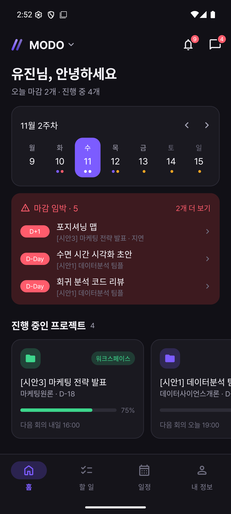 | 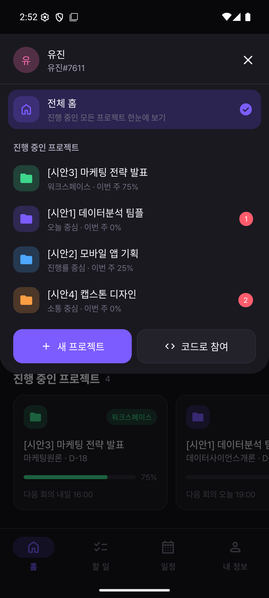 | 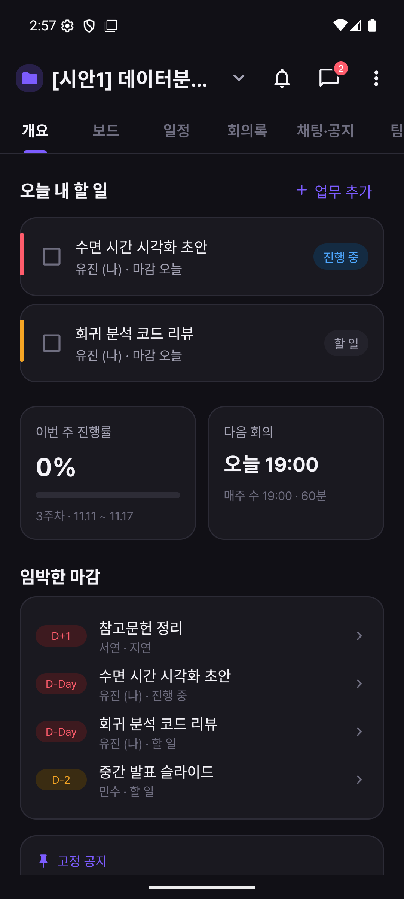 | 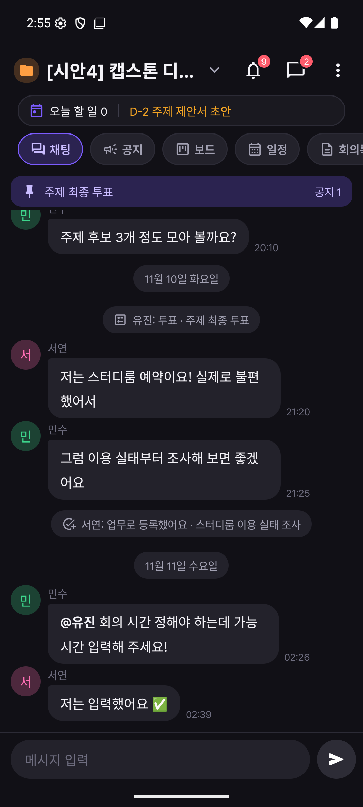 |

| 시안 2 진행률 중심 | 시안 3 워크스페이스 | 회의 시간 찾기 | 회의록 AI 요약 |
|---|---|---|---|
| 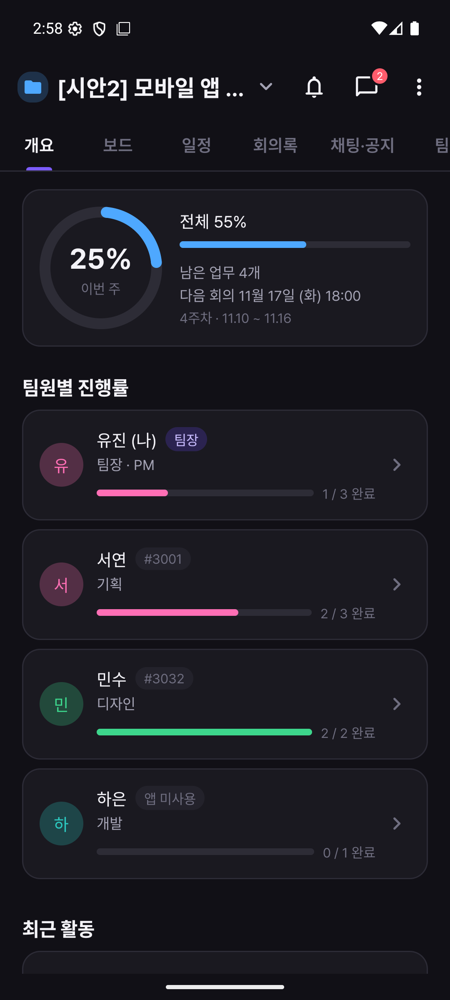 | 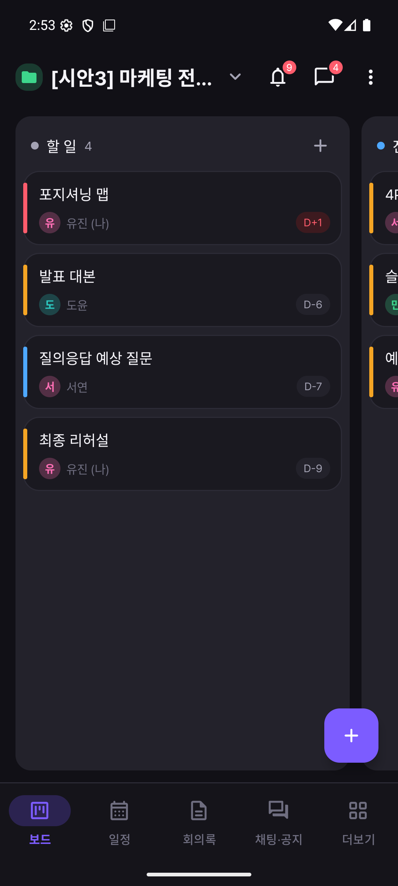 | 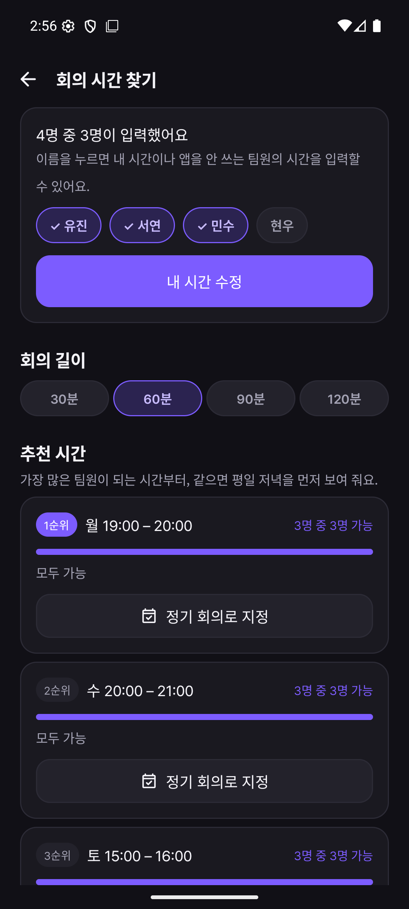 | 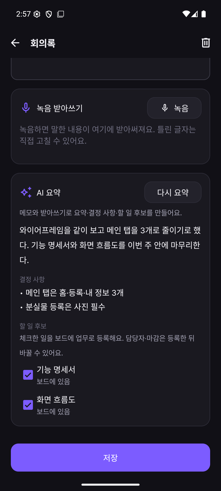 |

| 채팅 사진·파일 | 파일함 | Google 로그인 |
|---|---|---|
| 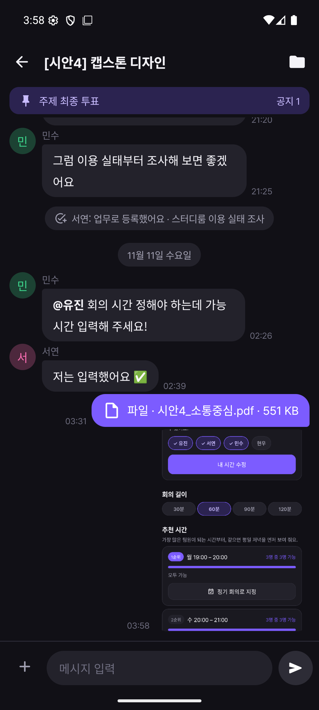 | 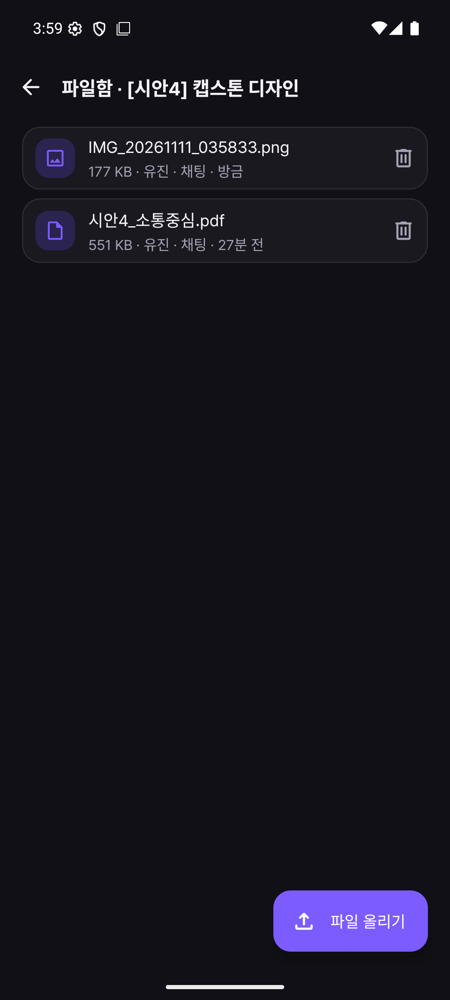 | 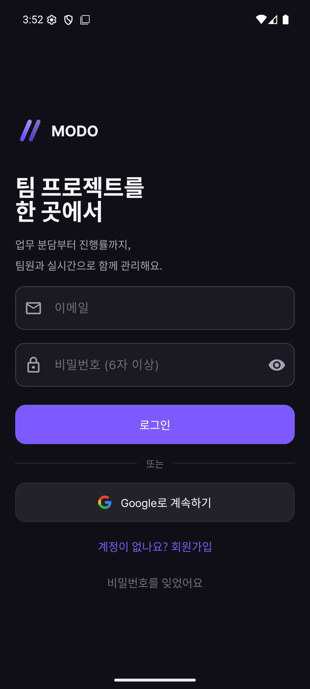 |

## 1. v0.2에서 바뀐 것

| 회의 피드백 | 반영 |
|---|---|
| 넷플릭스 프로필처럼 전체 홈 ↔ 프로젝트별 홈 | 왼쪽 위 이름을 누르면 위에서 전환 시트가 내려옵니다. 앱을 새로 켜면 전체 홈, 잠깐 나갔다 오면 보던 화면 |
| 홈 간결하게 | 통계 상자를 없애고 주간 캘린더 한 줄, 마감 임박 띠(지연·D-day), 진행 중 프로젝트 가로 카드, 선택한 날 일정만 |
| when2meet식 회의 시간 조율 | 요일 × 30분 격자에 끌어서 칠하기 → 팀 히트맵 → 추천 TOP 3 → 정기 회의로 지정 |
| 카톡식 채팅 · 파일 | 모든 화면 오른쪽 위 💬 → 팀방·1:1 목록, 안 읽은 수, @멘션, 공지·투표, 메시지 → 할 일. 채팅·업무·회의록에 사진·파일 첨부, 프로젝트 **파일함**(⋮ → 파일함)에 모아 보기 |
| 팀원 추가 | 이름#태그 또는 가입 이메일로 검색 → 프로필 확인 → 초대(수락해야 합류). 초대 코드·앱 안 쓰는 팀원 추가도 유지 |
| 이름 변경 | 앱 이름·패키지 모두 MODO (`com.modo.app`) |
| 버그 | 알림 숫자 잘림, 시간 선택을 시계 대신 휠로, "예정"에 지연 업무가 섞이던 분류 |
| 플로우 시안 4종 | 프로젝트마다 **화면 모드**를 고릅니다(라이트/다크처럼 팀 전체 적용). 시안 1 오늘 중심 · 2 진행률 중심 · 3 워크스페이스(보드) · 4 소통 중심 |

그 밖에: 회의록(검색, 녹음 받아쓰기, AI 요약 → 할 일 후보를 보드에 등록), 알림 화면(초대·마감·공지·멘션·회의 추천 변경), 가입 직후 "보통 되는 시간" 질문, 가로 화면 2단 홈, Google 계정으로 가입·로그인.

## 2. 바로 설치해서 써 보기 (APK)

1. `release/MODO-v0.2.1.apk`를 안드로이드 폰으로 옮겨 설치합니다. 설치 중 "출처를 알 수 없는 앱"을 허용해야 합니다. iPhone에는 설치할 수 없습니다. 예전 버전(v0.2.0)이 깔려 있으면 그 위에 덮어 설치되고, 로그인·데이터는 그대로입니다.
2. 이메일로 회원가입하거나 **Google로 계속하기**를 누릅니다. 처음이면 "보통 언제 시간이 되나요?"가 먼저 나옵니다. 칠하거나 건너뛰면 됩니다.
3. 프로젝트에 들어가는 방법
   - 팀원이 내 태그(내 정보에 표시)나 가입 이메일로 초대 → 알림에서 **수락**
   - 받은 6자리 초대 코드로 **코드로 참여**
   - 시연용 시안 1~4 프로젝트의 코드와 시연 계정은 단톡방에 따로 공유합니다 (공개 저장소라 여기에 적지 않음).
4. 인터넷이 필요합니다. 잠깐 끊겨도 기기에 먼저 저장되고, 다시 연결되면 자동으로 동기화됩니다.

## 3. Android Studio에서 열기

| 항목 | 버전 |
|---|---|
| Android Studio | 2026.1.x |
| AGP / Gradle | 9.3.3 / 9.5.0 |
| Kotlin | 2.4.21 (루트 `build.gradle.kts`에서 지정) |
| compileSdk / targetSdk / minSdk | 37 / 37 / 26 |
| Firebase BoM | 35.1.0 (auth, firestore, ai, appcheck-debug) |
| Google 로그인 | Credential Manager 1.6.0, googleid 1.2.1 |
| JDK | Android Studio 내장 JBR |

1. **File → Open**으로 이 폴더를 열고 Gradle Sync가 끝날 때까지 기다립니다. 경로에 한글이 없어야 합니다.
2. ▶ Run을 누릅니다. `app/google-services.json`이 들어 있어서 Firebase 설정을 따로 하지 않아도 됩니다.
3. 에뮬레이터는 **API 36 이미지를 쓰세요.** API 37 이미지는 현재 에뮬레이터와 맞지 않아 화면이 계속 재시작됩니다.

> Kotlin 버전을 2.4.21로 올린 이유: Firebase BoM 35 라이브러리는 Kotlin 2.4로 빌드돼 있는데, AGP 9에 내장된 Kotlin 2.2로는 읽지 못해 컴파일 에러가 납니다.

테스트 실행: `gradlew :app:testDebugUnitTest` — 104개 (업무 분류, 진행률, 주차, 회의 시간 추천·가능 시간 비트 연산, 태그·검색어, 주간·월간 캘린더, 알림·최근 활동, 회의록 AI 응답 해석·담당자 매칭, 메시지→할 일, 첨부 파일 경로·형식·크기, Firestore 변환)

## 4. 화면 구조

```
전체 홈 (하단 탭: 홈 · 할 일 · 일정 · 내 정보)
  └ 왼쪽 위 이름 → 전환 시트 → 프로젝트 홈 (모드에 따라 배치가 다름)
       시안 1 오늘 중심     상단 탭: 개요(오늘 내 할 일) · 보드 · 일정 · 회의록 · 채팅·공지 · 팀원
       시안 2 진행률 중심   상단 탭: 개요(진행률 링·팀원별 진행률·최근 활동) · …
       시안 3 워크스페이스  하단 탭: 보드 · 일정 · 회의록 · 채팅·공지 · 더보기
       시안 4 소통 중심     팀 채팅 + 위 띠(오늘 할 일·가까운 마감) + 칩: 채팅 · 공지 · 보드 · 일정 · 회의록 · 팀원
모든 화면 오른쪽 위: 🔔 알림 · 💬 채팅 목록 (안 읽은 수)
```

## 5. Firebase

| 항목 | 내용 |
|---|---|
| 프로젝트 ID | `teamup-mof-zsuyt` (Spark 무료 요금제) |
| 로그인 | Firebase Authentication (이메일/비밀번호, Google) |
| 데이터베이스 | Cloud Firestore, 서울 리전 (`asia-northeast3`) |
| 보안 규칙 · 색인 | `firestore.rules`, `firestore.indexes.json` |
| AI 요약 | Firebase AI Logic → Gemini Developer API (`gemini-3.8-flash`) |
| 파일 저장 | Supabase Storage (아래 "파일 저장" 참고) |

- 이 저장소는 공개 상태라 `google-services.json`의 API 키도 공개됩니다. 키는 쓸 수 있는 API가 제한돼 있고, 데이터는 보안 규칙이 팀원에게만 열어 줍니다. 결제가 연결돼 있지 않아 과금되지 않습니다.
- 규칙·색인 배포: `firebase deploy --only firestore:rules,firestore:indexes`
- 보안 규칙이 지키는 것
  - 프로젝트와 그 아래 문서(팀원·업무·공지·회의록·파일·초대)는 그 프로젝트 팀원만 읽고 씁니다.
  - 합류는 맞는 초대 코드가 있거나, 나에게 온 초대를 수락했을 때만 됩니다.
  - 팀원 내보내기는 팀장만, 팀장 넘기기는 팀장만 합니다.
  - 채팅방은 참여자만 읽고, 메시지는 보낸 사람 본인 이름으로만 씁니다. 팀방 참여자는 프로젝트 팀원과 같아야 합니다.
  - 이름#태그·이메일 검색 문서는 하나씩만 조회되고 목록으로 훑을 수 없습니다.

```
users/{uid}                          name, email, tag, school, avatarColor, availability(7칸), notifReadAt
userHandles/{이름#태그}, userEmails/{이메일}   검색용 공개 프로필
inviteCodes/{code}                   projectId, ownerUid
projects/{id}                        name, subject, 기간, meetingDay·Time·DurationMin·Decided, mode, ownerUid, memberUids …
  members/{id}                       name, role, uid(앱 사용자)/null, tag, availability, availabilityAt
  tasks/{id}                         title, assigneeId, dueDate, priority, status, attachments, sourceRoomId·MessageId …
  notices/{id} (+ votes/{uid})       title, body, pinned, poll
  minutes/{id}                       title, meetingDate, body, transcript, summary(overview·decisions·actions), attendeeIds, attachments
  files/{id}                         attachment(name·size·mime·path·uploadedBy), uploadedByName, source(chat·task·minutes·direct), sourceId
  invites/{id}                       toUid, fromUid, status(PENDING·ACCEPTED·DECLINED·CANCELED)
chatRooms/{p_프로젝트 | d_uid_uid}   memberUids, lastMessage, unread.{uid}
  messages/{id}                      senderUid, type(TEXT·IMAGE·FILE·NOTICE·POLL·TASK·SYSTEM…), text, file, mentions, refId
```

### AI 요약을 켜려면 (콘솔 1회)

코드는 들어 있지만 콘솔 설정 전에는 "AI 요약을 하지 못했어요"가 나옵니다.
1. Firebase 콘솔 → **AI Logic → 시작하기 → Gemini Developer API**
2. Google Cloud 콘솔 → API 및 서비스 → 사용자 인증 정보 → Android 키의 API 제한에 **Firebase AI Logic API**, **Firebase App Check API** 추가
3. App Check가 AI Logic에 자동 적용돼 있으므로, 디버그 빌드를 실행한 기기의 Logcat `DebugAppCheckProvider` 비밀값을 콘솔 **App Check → 앱 → 디버그 토큰 관리**에 등록 (또는 적용 시점을 늦춤)
4. 무료 요금제에서는 보낸 내용이 Google 제품 개선에 쓰일 수 있어, 앱이 처음 요약할 때 안내합니다.

### 파일 저장 (Supabase Storage)

Firestore는 파일을 담을 수 없어서 사진·파일만 Supabase Storage에 둡니다. 로그인은 Firebase 하나로 통일했습니다.

| 항목 | 내용 |
|---|---|
| 프로젝트 · 버킷 | `esmoraausbtnzbnpqreb` · 비공개 버킷 `modo-files` (파일당 50MB) |
| 인증 | Supabase **Third-party Auth**에 이 Firebase 프로젝트를 등록 → 앱은 Firebase ID 토큰을 그대로 보냄 |
| 앱 설정 | `res/values/supabase.xml` (URL, publishable 키 — 공개용 키라 저장소에 있어도 됨) |
| 경로 | `projects/{프로젝트ID}/{UUID}.{확장자}`, `dm/{방ID}/{UUID}.{확장자}`. 원래 파일 이름은 Firestore 첨부 정보에 저장 |

- 접근 규칙(RLS): 이 Firebase 프로젝트로 로그인한 사용자만 올리고 받을 수 있고, 목록 조회는 막혀 있으며, 지우기는 올린 사람만 됩니다.
- 한계: Supabase는 Firestore의 팀원 명단을 모르므로 "같은 앱 로그인 사용자 + 추측할 수 없는 파일 경로"까지만 지킵니다. 파일 경로는 Firestore 규칙에 따라 그 프로젝트 팀원에게만 보입니다.
- 파일함에서 파일을 지우면 그 파일을 보낸 채팅 메시지는 함께 지워지고, 업무·회의록 첨부 목록에서도 빠집니다.
- 무료 요금제 한도(저장 1GB 등)는 Supabase 요금 안내를 따릅니다. 일주일 넘게 요청이 없으면 프로젝트가 일시 정지될 수 있으니, 그때는 Supabase 대시보드에서 다시 켭니다.

## 6. 아직 남은 것

| 항목 | 상태 |
|---|---|
| Google 로그인 실제 확인 | 구현 완료. 에뮬레이터에는 Google 계정이 없어 계정 추가 화면까지만 확인했습니다. 실기기에서 한 번 로그인해 보면 됩니다 |
| AI 요약 실제 호출 | 코드 완료. 위 "AI 요약을 켜려면" 콘솔 설정 후 동작 |
| 실제 녹음 받아쓰기 | 화면·권한·재시작 처리 완료. 에뮬레이터는 마이크 입력이 꺼져 있어 실기기에서 확인 필요 |

## 7. 규칙

- **주간 진행률**: 주차는 정기 회의일부터 다음 회의 전날까지. 업무는 마감일이 속한 주차에 자동으로 들어갑니다.
- **업무 분류**: 완료 → 완료, 마감이 지났으면 **지연**(할 일·진행 중 목록에 섞이지 않음), 나머지는 상태대로.
- **회의 시간 추천**: 회의 길이만큼 연속으로 되는 팀원 수가 많은 순. 같으면 평일 → 저녁(18~22시) → 이른 요일·시간, 2순위부터는 다른 요일을 먼저. 가능 시간을 입력한 팀원만 셉니다.
- **알림**: 서버 푸시 없이 받아 온 데이터에서 만듭니다(초대, 내 업무 마감, 최근 공지, 나를 멘션, 회의 추천 변경). 알림 화면을 본 뒤에 생긴 것만 배지에 셉니다.

계산 코드는 `logic/` 폴더에 있고 단위 테스트로 검증합니다. 자세한 설계: [`docs/specs/2026-11-11-modo-v2-design.md`](docs/specs/2026-11-11-modo-v2-design.md)

## 8. 코드 구조

```
app/src/main/java/com/modo/app
├─ ModoApp.kt              테마 적용, App Check(디버그)
├─ data/                   Models, DataHub(LiveData로 합침), Session, Profile·Team·Invite·Chat Repository,
│                          FirestoreMapper, AiSummarizer, AuthService(이메일·Google), FileStore(Supabase), Prefs, SampleData
├─ logic/                  TaskRules, ProgressCalculator, WeekCalculator, Schedule, CalendarMath, Availability,
│                          MeetingFinder, NotificationFeed, ActivityFeed, UserTag, MessageTask, MinutesAi, FileRules …
│                          (안드로이드와 무관한 순수 Kotlin → app/src/test 에서 테스트)
└─ ui/
   ├─ root/                RootActivity(하단 탭) + HomeTab, TasksTab, ScheduleTab, MyInfoTab
   ├─ nav/                 AppBar(전환·알림·채팅 배지), SwitcherSheet, Nav
   ├─ project/             ProjectActivity(모드별 배치) + sections/(개요 2종·보드·일정·회의록·채팅·공지·팀원·더보기)
   ├─ chat/                ChatListActivity, ChatRoomActivity, ChatRoomController, 공지·투표
   ├─ meeting/             AvailabilityGridView(커스텀 View), AvailabilityActivity, MeetingFinderActivity
   ├─ minutes/             MinutesEditActivity, SpeechSession(받아쓰기)
   ├─ files/               FilesActivity(파일함), AttachPicker(사진·파일 고르기), AttachmentsEditor, FileActions(열기·미리보기·삭제)
   ├─ member/ notify/ task/ search/ auth/ common/
```

모든 화면은 `DataHub.data`(LiveData)를 observe합니다. 쓰기는 Firestore에 바로 하고, 리스너가 바뀐 내용을 다시 내려주면 모든 화면이 자동으로 갱신됩니다.

## 9. 수업 내용 적용 위치

자세한 표: [`docs/specs/2026-11-11-modo-v2-design.md` §7](docs/specs/2026-11-11-modo-v2-design.md)

- **위젯:** TextView·EditText·Button·ImageView, CheckBox(업무 완료·할 일 후보), RadioGroup(모드·회의 길이·필터·테마·언어), NumberPicker(시간 휠)
- **레이아웃:** LinearLayout, FrameLayout, GridLayout(월간 캘린더), ConstraintLayout(업무 수정), ScrollView·HorizontalScrollView
- **이벤트:** 클릭, 길게 누르기(메시지 → 할 일, 보드 카드 이동), **터치 끌기(가능 시간 격자 `onTouchEvent`)**, 키(Enter로 보내기·검색), 뒤로 가기(저장 안 한 변경 확인)
- **리소스:** `values-en`(영어), `values-night`(다크), `layout-land`(가로 2단 홈), `font`(Pretendard), `mipmap`(앱 아이콘)

## 10. 라이선스 메모

- 글꼴 Pretendard Std: SIL Open Font License 1.1 (`docs/licenses/Pretendard-OFL.txt`)
- 아이콘 Material Symbols: Apache License 2.0
